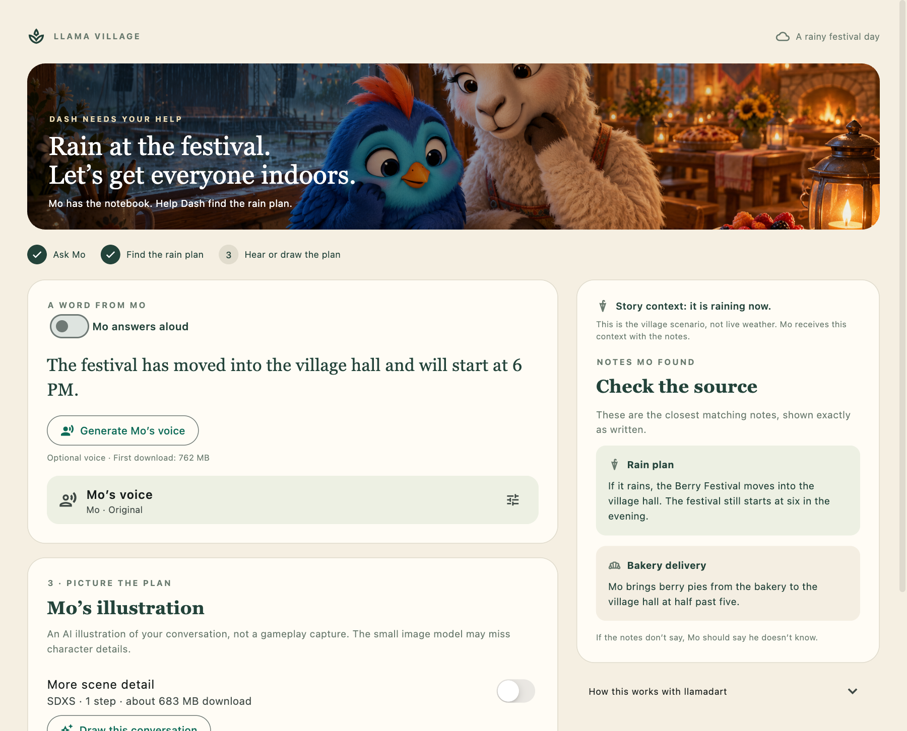

# Festival Notebook

A small Flutter app where Dash asks Mo, the village baker, for help with the Berry Festival. Built with [llamadart](https://github.com/leehack/llamadart): local search, answers, speech and illustrations in one example.


Rain interrupts the festival. Ask where to go, check the notes Mo used, hear his reply, and draw the conversation. Type a question, speak into the microphone, or try Dash’s bundled sample.

## Run it

Developed and tested with **Flutter 3.47.7 / Dart 3.13.5**. Use a supported native host toolchain or a WebGPU-capable browser. Dependencies and model revisions are pinned.

```sh
git clone https://github.com/leehack/festival-notebook.git
cd festival-notebook
flutter pub get
flutter run -d macos
```

For a connected Android device, choose its ID from `flutter devices`. For iOS, open `ios/Runner.xcworkspace`, select your own signing team and device, then run with Flutter. Native inference needs a supported device architecture; an emulator result does not establish physical-device performance.

### First conversation

1. Ask **“It is raining. Where is the Berry Festival now?”**
2. Mo searches three festival notes and answers. Inspect the matching notes beside his reply.
3. Toggle **Mo answers aloud**, choose his voice, or draw the conversation.
4. Try **“Who won last year?”** to see how the model handles a missing fact.

Models download on first use through llamadart’s download manager. Allow roughly **0.9 GB** for search and answers, **1.02 GB** more for transcription, **762 MB** for speech and **683 MB** for the default image model. These are download sizes, not RAM requirements. Speech can be slow on phones. Turn off automatic speech for a faster text-only first run.

No API key or inference server is needed. Models run on the device; network access is used to download the app/runtime assets and models. Cached native models can be used offline. Browser storage may be evicted.

### Web

```sh
dart run tool/prepare_web.dart
flutter build web --release
dart run tool/serve_web.dart
```

Open **http://127.0.0.1:8765** in a WebGPU-capable browser. Runtime files are pinned and checksum-verified; they are not committed to Git.

For deployment, serve `build/web` over HTTPS with these response headers:

```text
Cross-Origin-Opener-Policy: same-origin
Cross-Origin-Embedder-Policy: require-corp
```

`web/_headers` is included for hosts that support it. Keep runtime files on the same origin. For a subdirectory deployment, build with `--base-href /your-path/`. Image generation is disabled on web. Speech and microphone support depend on the browser, hardware, permissions and available memory.



## Read the code

Start with [lib/festival_ai.dart](lib/festival_ai.dart). The core flow is:

```dart
final hits = await retrieve(question);
final reply = await answer(question, hits);
```

`retrieve` embeds the notes and question, then ranks their normalized vectors. `answer` supplies the best two notes and the scene context to the language model. Each function releases its engine in `finally`, keeping large models from accumulating in memory.

| File | Responsibility |
| --- | --- |
| [festival_ai.dart](lib/festival_ai.dart) | Model sources, retrieval, grounded answers, speech and images |
| [notebook_controller.dart](lib/notebook_controller.dart) | One operation at a time, progress, errors and output state |
| [main.dart](lib/main.dart) | Responsive village UI and playback |
| [microphone.dart](lib/microphone.dart) | Bounded in-memory recording and WAV encoding |
| [silence_detector.dart](lib/silence_detector.dart) | Energy-based end-of-speech detection |
| [voice_recorder.dart](lib/voice_recorder.dart) | Record, preview and apply a reference voice |

See [how it works](docs/how-it-works.md) for the pipeline and [platform notes](docs/platforms.md) for supported paths and measured limits.

## What to expect

- The notebook contains three fixed notes, not a database or live weather service. The story explicitly says it is raining.
- Small models can still invent facts. The source panel lets you check Mo’s answer; it does not prove that every answer is grounded.
- The illustration uses the latest reply, translated to English when needed. Names are described visually as llamas or a blue bird, but the image model cannot guarantee exact character identity.
- Silence detection is an audio-energy threshold, not neural VAD. In noise, switch to hold-to-talk. Questions are capped at 20 seconds.
- Mo has two synthetic reference voices. You can import or record your own short reference. It guides voice identity; it is not a promise to reproduce emotion or tone exactly. Use a voice you have permission to use.
- Reference recordings remain in memory for the session. Native playback writes a temporary WAV; no recordings are uploaded by the app.
- Speech uses a fresh engine per request. Unpublished reuse and Vulkan workarounds are not enabled in this public example.

## Check changes

```sh
dart format --output=none --set-exit-if-changed lib test integration_test tool
flutter analyze
flutter test
```

The automated checks do not download models. An optional real-model smoke test exercises the actual question-to-answer flow:

```sh
flutter test integration_test/text_test.dart -d macos
```

That test downloads models on first use and checks the location, brevity and known misleading timing claims. It is not a speech-quality or full cross-platform qualification test.

## Credits and license

Inspired by [Llama Village](https://github.com/leehack/llama-village). The cover is AI-generated; bundled voice samples are synthetic. See [asset credits](ASSETS.md).

Example code and bundled project assets are provided under [MIT](LICENSE). Downloaded runtimes, dependencies and models retain their own licenses; model weights are not bundled here.
