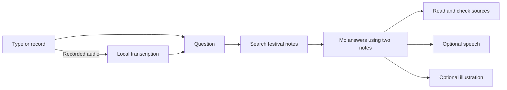

# Follow a question through the notebook

## Read one task at a time

- [answer.dart](../lib/ai/answer.dart): select two notes and build Mo’s prompt.
- [search.dart](../lib/ai/search.dart): embed, compare and rank the notes.
- [transcribe.dart](../lib/ai/transcribe.dart): turn a WAV into text.
- [speak.dart](../lib/ai/speak.dart): turn a reply and reference voice into a WAV.
- [illustrate.dart](../lib/ai/illustrate.dart): turn a scene prompt into a PNG.

The shared [text generator](../lib/ai/generate_text.dart) handles loading, streaming and disposal for answers and translations. [Image prompt preparation](../lib/ai/image_prompt.dart) holds the character descriptions and translation step. [models.dart](../lib/ai/models.dart) contains all pinned model sources and runtime settings, separate from the task logic.

Each task is an ordinary Dart function. Start there; the service and controller connect those functions to the app and make the flow testable.

## Search, then answer

`retrieve` uses EmbeddingGemma to embed the three notes and the question. Its inputs use the model’s document and query prefixes. Vectors are normalized, so a dot product ranks their similarity. `FestivalService` keeps the fixed note vectors in a session cache. Each question still loads and disposes the embedding engine, but only the first successful search embeds the notes. The cache contains vectors, never a native engine.

`answer` gives Qwen3.5 0.8B the top two notes, the fictional scene context and the question. The system prompt asks for a brief reply and an admission when facts are missing. Prompts reduce mistakes but do not enforce factual correctness. The source cards show the notes verbatim.

These are separate model loads. Search finishes and disposes its engine before the answer model loads. This favors a readable example and bounded model residency over maximum throughput. Downloads remain cached even when an engine is disposed.

## Add a voice

Recorded questions are 16 kHz mono PCM, held in memory and wrapped as WAV for Qwen3-ASR. A quiet interval ends the recording when automatic stopping is enabled. The transcript is then sent to Mo; it remains editable afterward. Imported WAV files are shown for review before asking.

Speech uses Qwen3-TTS 0.6B with Mo’s selected reference clip, language and a fixed seed. The engine is disposed after each reply. Playback reuses the generated WAV; changing the reference clears it. The published runtime’s repeated-synthesis behavior is why the public example does not retain a TTS engine.

The voice recorder lets you record, preview, discard or apply a short reference. Choosing a reference does not change the wording of Mo’s answer.

## Draw the reply

English replies can be used directly. Other reply languages are translated with the existing language model. Known names receive visual descriptions: June and Pip become llamas, and Dash becomes a small blue bird. The action comes first because the image model has a short conditioning window.

SDXS generates a 512 × 512 image in one step. The optional SD-Turbo profile uses four steps and larger model files. Every new illustration gets a new seed. The UI shows the exact prompt and seed so the result can be inspected.

This is text-to-image generation, not a screenshot of the game and not image-conditioned character rendering. It can miss characters or actions.

## State and lifetime

`NotebookController` exposes read-only state and explicit actions. Widgets call those actions rather than changing busy flags, answers or audio directly. `FestivalService` is injectable, so tests can exercise a complete turn without loading models. The screen owns microphone and playback lifetime; the cards in `widgets/` render state and forward user actions.

`NotebookController.work` admits one operation at a time, clears transient errors, and restores the UI after failures. Optional speech/image failures preserve the text answer. Model functions own loading and disposal; the UI owns playback and microphone lifetime.

The sample is intentionally session-local. It does not persist chat history, user voice references or a user database. Add persistence only when the product needs it.
